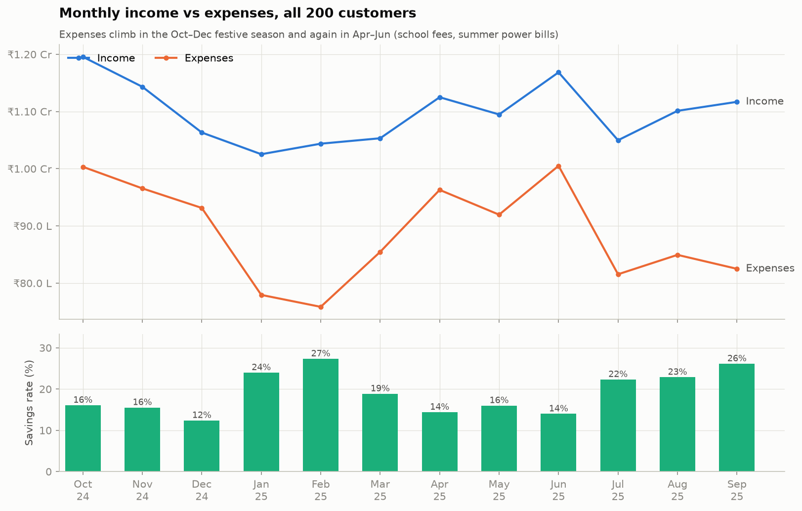
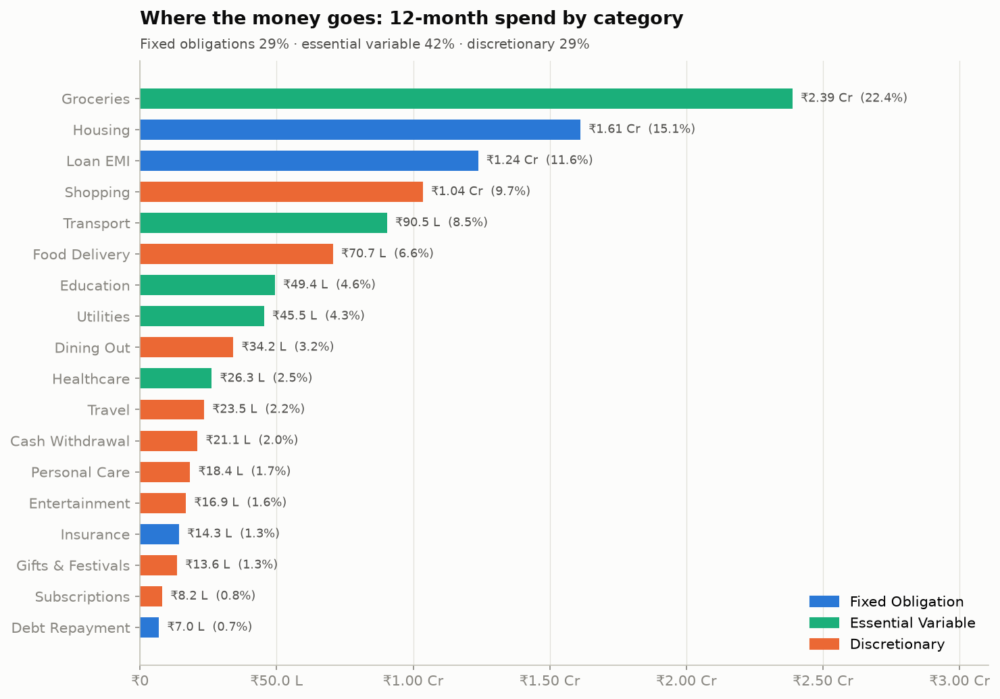
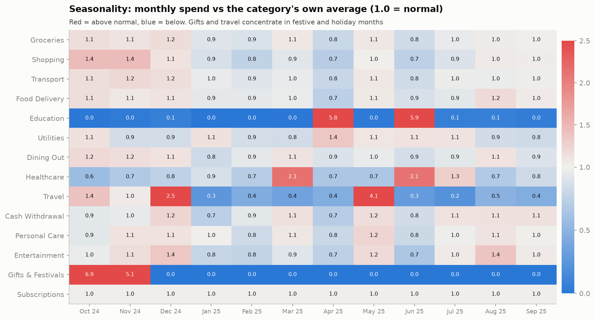
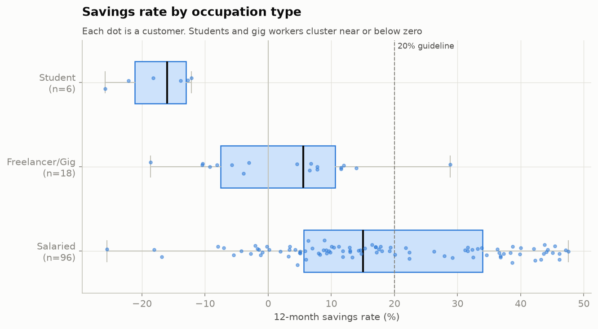
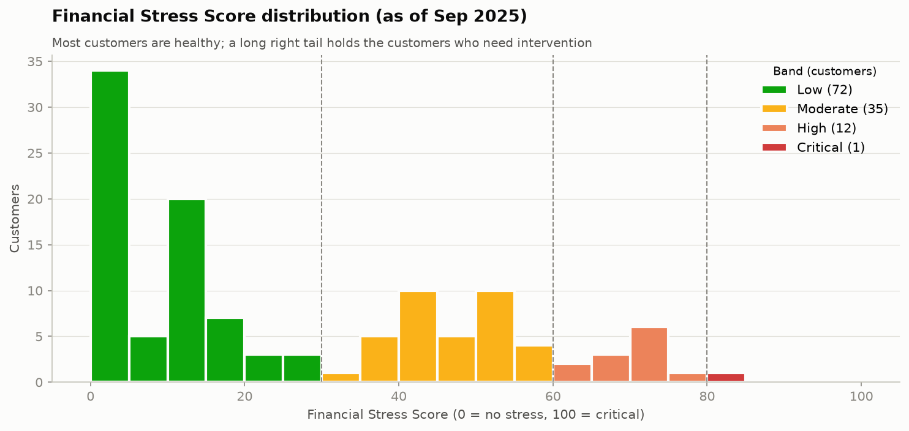
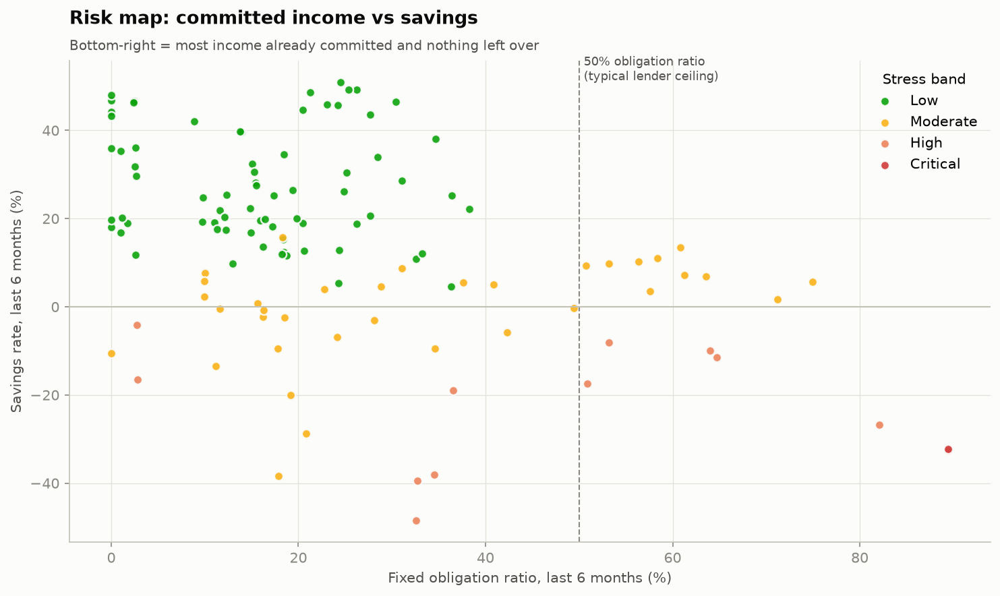

# Financial Stress & Cash-Flow Risk Analytics

> **Who is financially stressed, why, and who will run out of cash next month?**
> This end-to-end analytics project turns 41,000 bank transactions into a validated 0–100 Financial Stress Score, a backtested next-month cash-flow forecast, and a prioritised action list for management.

    

---

## Project description

Banks usually notice financial distress only once it has happened: a bounced EMI, a missed card payment, a loan-app default. The warning signs show up months earlier in ordinary transaction data:
- shrinking savings
- rising fixed commitments
- thinning balances
- small emergency borrowings

This project builds the full analytics workflow to detect those signs. It covers synthetic data generation, measurable data cleaning, EDA, 20 SQL analyses, an explainable stress score, a cash-flow forecast, model validation, a Power BI dashboard design, and management recommendations.

## Business problem

A retail bank or personal-finance app wants to:

1. Understand how customers earn, spend and save.
2. Identify customers under financial stress, and the **reason** for it.
3. Predict who is likely to face a **cash shortfall next month**, so it can intervene early with a reminder, a payment-date change, or a lower-cost credit option, before the customer turns to high-cost borrowing.

## Objectives

- Build a realistic, internally consistent transaction dataset (balances reconcile to the rupee).
- Clean it measurably: every issue fixed is graded against a log of the issues injected.
- Develop KPIs for cash flow, savings, obligations, buffers, volatility and behaviour.
- Create a transparent, **benchmark-anchored** Financial Stress Score (0–100).
- Forecast next-month cash-flow risk, and **backtest** it without look-ahead.
- Communicate results through Power BI, Excel and Finding → Evidence → Impact → Recommendation insights.

## Dataset

There is no public dataset with multi-customer transactions **and** a consistent running balance, so the data is simulated by `src/generate_data.py` (seed 42, configurable).

| Item | Value |
|---|---|
| Customers | 120 (7 hidden behavioural personas, used only for validation) |
| Period | Oct 2024 – Sep 2025 (12 months) |
| Transactions | 41,711 raw → 41,135 clean |
| Context | INR, 22 Indian cities (Tier 1/2/3), UPI / NACH / NEFT / cards, Diwali and school-fee seasonality, SIPs, instant-loan apps |
| Injected issues | 7,551 issues across 13 types (duplicates, text amounts, paise errors, mixed dates, typos, missing values...) |

Full column definitions are in [`data/data_dictionary.md`](data/data_dictionary.md).

## Tech stack

| Tool | Used for |
|---|---|
| **Python** (Pandas, NumPy) | Data generation, cleaning, feature engineering, scoring, forecasting, validation |
| **Matplotlib** | EDA figures (colour-blind-safe palette) |
| **PostgreSQL** | Star-style schema, analytical views, 20 business queries |
| **Power BI** | 4-page dashboard: star schema, 52 DAX measures, custom theme |
| **Excel** (openpyxl) | Formula-driven management summary |
| **Jupyter** | Executed walkthrough notebooks |

## Project workflow

```
generate_data ──► raw CSVs (+ injected-issue log)
      │
clean_data ─────► clean CSVs + data-quality scorecard
      │
features ───────► customer × month table
      │
      ├─► stress_score ─────► 0–100 score, 7 factors, top driver
      ├─► cashflow_forecast ► next-month expected balance + deficit probability
      │
validate_model ─► backtest, early-warning, persona and sensitivity tests
      │
      ├─► eda ─────────────► 12 figures + EDA tables + key metrics
      ├─► run_sql ─────────► PostgreSQL schema, views, 20 queries → sql/results/
      ├─► export_powerbi ──► star-schema CSVs
      └─► build_excel ─────► management_summary.xlsx
```

## Folder structure

```
financial-stress-cashflow-analytics/
├── README.md
├── run_pipeline.py                 # one command rebuilds everything
├── requirements.txt
├── config/generator_config.yaml    # seed, customers, persona mix, dirty-data rates
├── data/
│   ├── raw/                        # dirty data + injected-issue log (+ hidden truth files)
│   ├── processed/                  # cleaned transactions & customers, cleaning log
│   ├── analytics/                  # customer_month, stress scores, forecast, validation
│   ├── powerbi/                    # star schema for Power BI
│   └── data_dictionary.md
├── src/                            # generate, clean, features, score, forecast, validate, eda, sql, exports
├── sql/
│   ├── 01_schema.sql  02_load_data.sql  03_views.sql  04_analysis_queries.sql
│   └── results/                    # output of all 20 queries
├── notebooks/                      # 6 executed walkthrough notebooks
├── powerbi/                        # build guide, DAX measures, theme JSON
├── excel/management_summary.xlsx
├── reports/
│   ├── figures/                    # EDA charts
│   ├── eda_tables/
│   ├── data_quality_report.md
│   ├── model_validation.md
│   ├── insights_report.md
│   └── key_metrics.json
└── docs/
    ├── PORTFOLIO_DOCUMENTATION.md  # full 13-section write-up
    ├── stress_score_methodology.md
    ├── cashflow_risk_methodology.md
    ├── sql_analysis.md
    ├── interview_talking_points.md
    └── screenshots/                # add Power BI screenshots here
```

## Data cleaning highlights

- Every one of the 13 injected issue types was detected (99.4–100%), and **zero balance-chain breaks** remain.
- **Balance reconciliation** catches unit errors. 123 amounts recorded in paise (0.3% of rows) would otherwise have overstated spending by **27%**.
- Imputation uses only reliable relationships. Unrecoverable merchants become `Unknown Merchant` instead of being guessed.
- Outliers are flagged, not deleted, because a hospital bill is real behaviour.

Details: [`reports/data_quality_report.md`](reports/data_quality_report.md)

## Python analysis (EDA)

| | |
|---|---|
|  |  |
|  |  |
|  |  |

## SQL analysis

There are 20 PostgreSQL queries, each answering a stated business question. They use CTEs, window functions (LAG, running totals, framed moving averages, RANK, ROW_NUMBER, NTILE), gaps-and-islands, CASE pivots, subqueries and HAVING.

| Example question | Technique |
|---|---|
| Which customers spent > 1.5× their own trailing 3-month average? | `AVG() OVER (ROWS BETWEEN 3 PRECEDING AND 1 PRECEDING)` |
| Who had 3+ consecutive months of falling balance? | LAG + gaps-and-islands with ROW_NUMBER |
| Does one loan-app borrowing lead to more? | First-event CTE + self-join |
| Who should we contact first next month? | Joins across the score and forecast tables with an action label |

All queries and findings: [`docs/sql_analysis.md`](docs/sql_analysis.md) · [`sql/04_analysis_queries.sql`](sql/04_analysis_queries.sql)

## Financial Stress Score

| Factor | 0 stress | 100 stress | Weight |
|---|---|---|---|
| Savings margin (6m) | ≥ 20% | ≤ −10% | 20 |
| Fixed obligation ratio (FOIR-style) | ≤ 30% | ≥ 60% | 20 |
| Emergency buffer | ≥ 6 months | ≤ 0.5 month | 20 |
| Income instability (CV) | ≤ 0.10 | ≥ 0.60 | 10 |
| Expense growth (de-seasonalised) | ≤ 0% | ≥ +25% | 10 |
| Balance trend | ≥ +0.5 mo. income | ≤ −1.0 | 10 |
| Deficit & borrowing frequency | 0 | max | 10 |

The bands are Low 0–30, Moderate 31–60, High 61–80 and Critical 81–100. The method is in [`docs/stress_score_methodology.md`](docs/stress_score_methodology.md).

**Validated:**

| Test | Result |
|---|---|
| Next-month borrowing rate by band | Low **0%**, Moderate 4.6%, High **16.7%**, Critical **75%** (AUC 0.93) |
| Hidden at-risk personas separated | AUC 0.94 |
| Stability under equal weights | 92% of customers keep the same band |

## Cash-flow risk forecast

Each customer's forecast combines four parts:
- **Expected income:** median or mean depending on volatility.
- **Expected outflows:** recurring obligations, recent variable spend adjusted by the seasonal index, and known one-offs.
- **Expected ending balance.**
- **Deficit probability:** the probability of the ending balance falling below a safety cushion of 25% of outflows.

**Backtest** (720 forecasts, no look-ahead):

| Metric | Result |
|---|---|
| Income error | 10% |
| Outflow error | 14% |
| Customers flagged High who then had a cash crunch | **44%**, against a **3.8%** base rate (12× lift) |
| AUC | 0.96 |

Method: [`docs/cashflow_risk_methodology.md`](docs/cashflow_risk_methodology.md)

## Power BI dashboard

| Page | Answers |
|---|---|
| 1. Executive Overview | Is the portfolio healthy and improving? |
| 2. Spending Intelligence | Where does the money go: categories, merchants, recurring spend, payment rails, weekends |
| 3. Financial Risk | Who is stressed, why (decomposition tree), and who runs short next month (watch-list) |
| 4. Customer Deep Dive | Drill-through: one customer's score, drivers, trend, forecast and red flags |

Build kit:
- [`powerbi/POWERBI_BUILD_GUIDE.md`](powerbi/POWERBI_BUILD_GUIDE.md): model, layout, visuals, slicers, drill-through
- [`powerbi/dax_measures.md`](powerbi/dax_measures.md): 52 measures, each explained
- [`powerbi/finstress_theme.json`](powerbi/finstress_theme.json)

### Screenshots

> Add your screenshots after building the dashboard.

| Executive Overview | Spending Intelligence |
|---|---|
|  |  |
| **Financial Risk** | **Customer Deep Dive** |
|  |  |

## Key insights

1. **Students and gig workers run deficits in 78% and 57% of months** (salaried: 18%). They are 20% of customers but 55% of borrowers.
2. **Fixed obligations above 50% of income** (15% of customers) means an average stress score of 54 against 20, and **none** scored Low.
3. **30% of customers hold less than 3 months of buffer.** The High-band median is 0.8 months.
4. **Diwali overspend turns into Dec–Jan borrowing**: 33% of borrowing months fall in those 2 months.
5. **94% of customers who used a loan app or card cash advance borrowed again**, so the first event is the trigger.
6. **Lifestyle creep is hidden in balances.** 10 customers grew spend 23–32% on flat income, and 9 of them still look Low or Moderate.
7. **The stress score is a reliable early warning.** No Low-band customer borrowed the following month.
8. **9 customers are flagged for October 2025, and 6 of them sit in the Moderate band.** The forecast catches what the score alone misses.

All 11 insights are in [`reports/insights_report.md`](reports/insights_report.md).

## Business recommendations

1. A weekly next-month watch-list, with **EMI or auto-debit dates realigned to after salary day**.
2. **Contact customers within 7 days of their first high-cost borrowing**, with a cheaper alternative.
3. A **fixed-obligation ratio ≤ 50% guardrail** on all new credit, plus restructuring offers.
4. **Automated buffer-building** towards a 3-month target.
5. A **pre-festive budgeting campaign** every September.
6. **Trend alerts** for rising spend on flat income.
7. **Balance reconciliation** as a mandatory data-pipeline check.

## How to reproduce

```bash
# 1. Install
git clone <your-repo-url> && cd financial-stress-cashflow-analytics
python -m venv .venv && source .venv/bin/activate     # Windows: .venv\Scripts\activate
pip install -r requirements.txt

# 2. Run the full Python pipeline (about 1 minute)
python run_pipeline.py

# 3. (Optional) SQL: needs PostgreSQL 13+ with the psql client on PATH
createdb finstress
python run_pipeline.py --sql          # or run sql/01..04 with psql -d finstress -f, from the project root

# 4. (Optional) Re-execute the notebooks
python src/build_notebooks.py

# 5. Power BI: follow powerbi/POWERBI_BUILD_GUIDE.md using data/powerbi/*.csv
```

- **Change the data:** edit `config/generator_config.yaml` (seed, customer count, persona mix, error rates) and rerun. All numbers in this README come from seed 42.
- **Excel recalculation:** `excel/management_summary.xlsx` uses live formulas. If you rebuild it, open it in Excel once to recalculate.

## Limitations

- The data is synthetic, so the results demonstrate methodology rather than real-world performance.
- Each customer has one account; money held elsewhere is invisible.
- There are only 12 months of history.
- Stress-score weights come from guidelines rather than from fitting to real default outcomes.

Full list and future improvements: [`docs/PORTFOLIO_DOCUMENTATION.md`](docs/PORTFOLIO_DOCUMENTATION.md#12-limitations)

---

*Author: [Your Name] · [LinkedIn] · [Email]*
